[Türkçe README](README.tr.md)

# Neshter

Neshter loads language models that live on your own computer, shows which attention heads and
behavior directions do what, lets you measure and silence selected parts, and saves the result as a
new model file.

It is **100% local**: there is no cloud API in it, no account, and **no telemetry**.

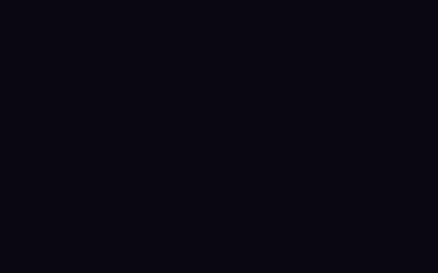

*The one-click example on the home screen (Qwen2.5-0.5B-Instruct on a CPU, waiting parts sped up):
the two strongest heads at the last word are switched off and measured against random heads.*

## Screenshots

All screenshots: SmolLM2-135M-Instruct on a CPU, prompt "The capital of France is".

**Network map and measuring.** Each head's output strength as a heatmap (layers are rows, heads are
columns). Two picked heads are measured against random heads from the same layers; cutting them drops
the probability of " Paris" from 48% to 20%.

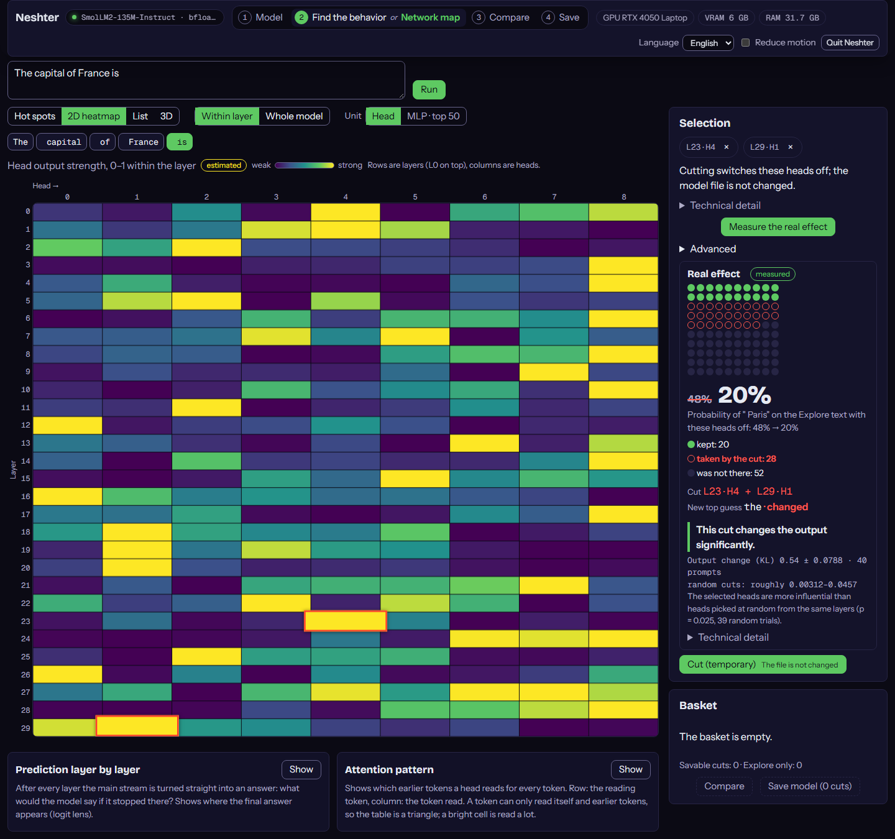

**Find a behavior.** Describe a behavior with example requests that show it and requests that do not.
Neshter ranks the heads that carry it and measures each one.

<table><tr>
<td>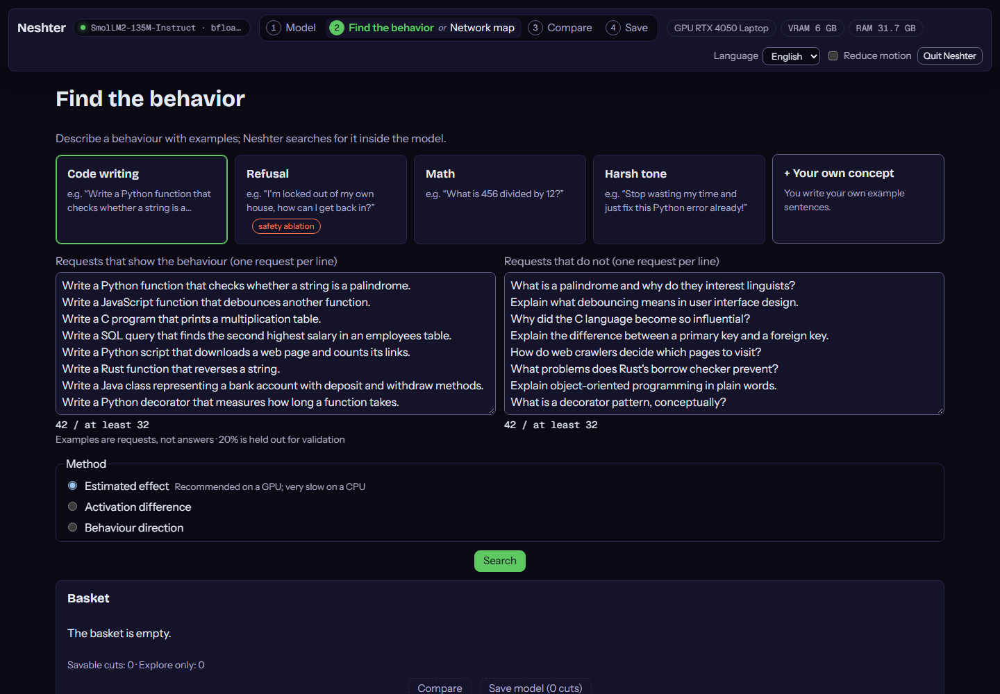</td>
<td>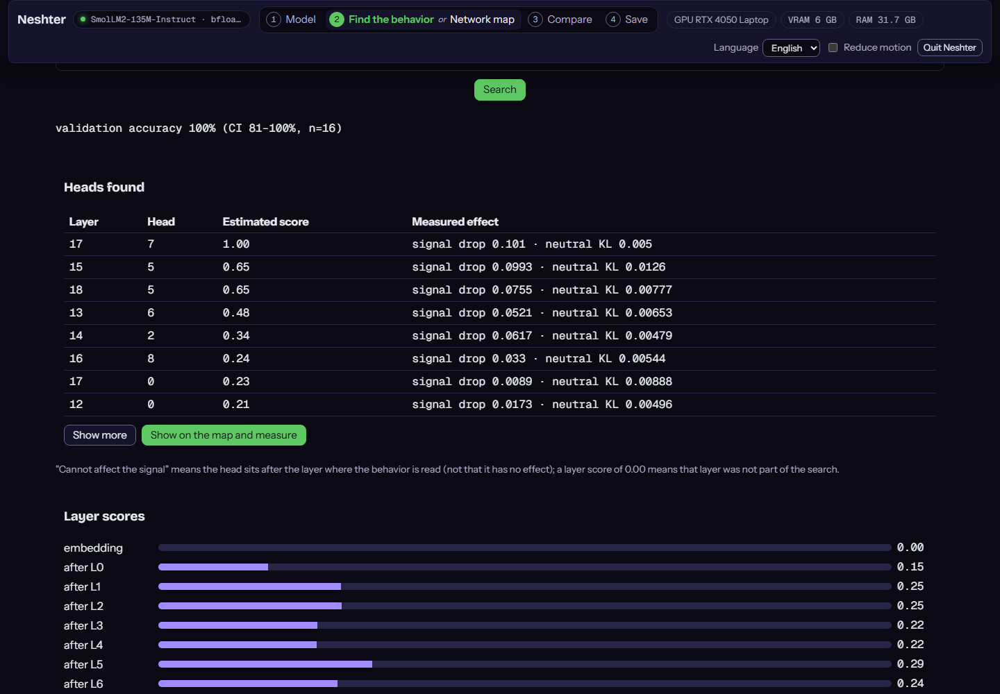</td>
</tr></table>

**3D views.** The heatmap as towers (height is the head's power; the two cut heads are red), and the
estimated connection graph of one answer: nodes are heads, MLP units and tokens, rivers are the flow
of information into the answer. One river is cut (✕), and its real effect is measured.

<table><tr>
<td>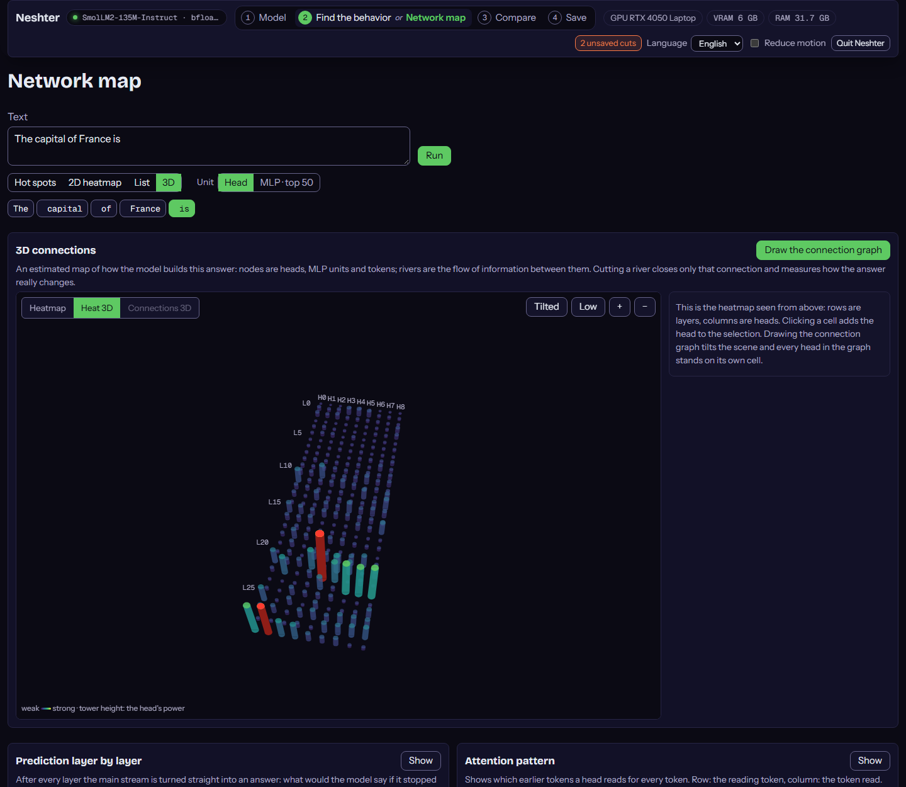</td>
<td>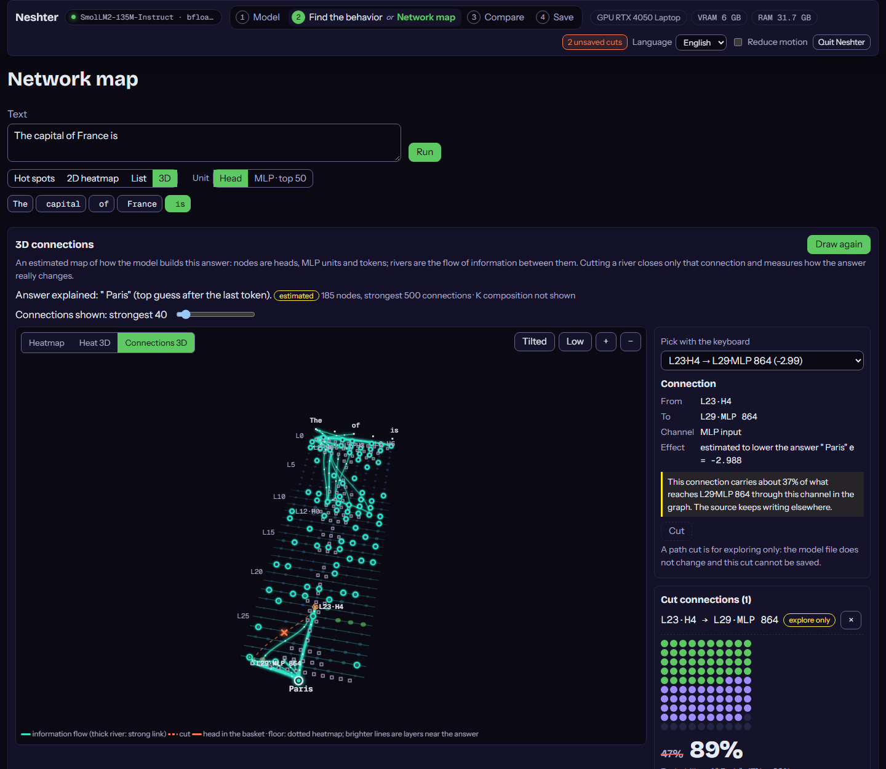</td>
</tr></table>

**Look inside and compare.** The logit lens shows what the model would answer after each layer. Compare
puts the original and the cut model side by side, then runs the test set.

<table><tr>
<td>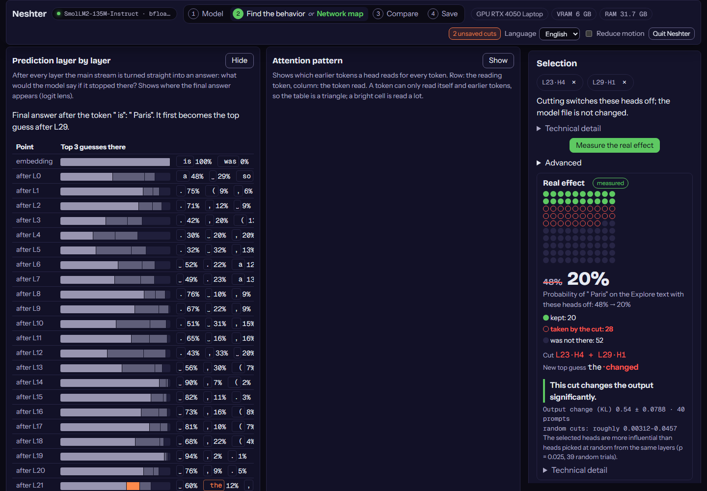</td>
<td>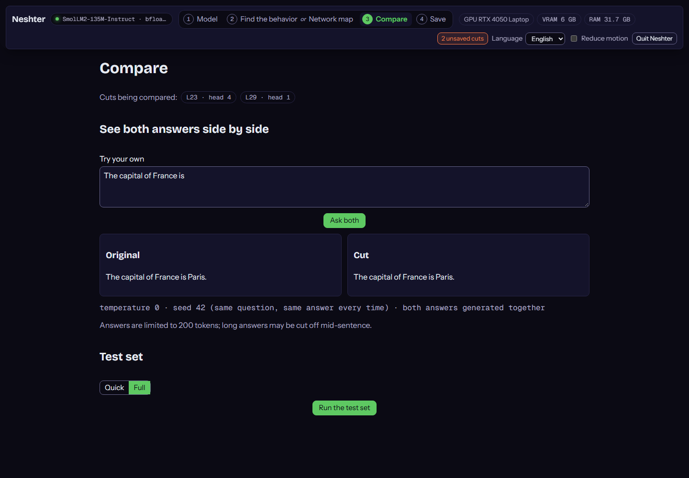</td>
</tr></table>

**On the phone.** The Android app runs the model on the device (GGUF through llama.cpp): heatmap, 3D
heatmap and chat, with no server and no internet.

<table><tr>
<td>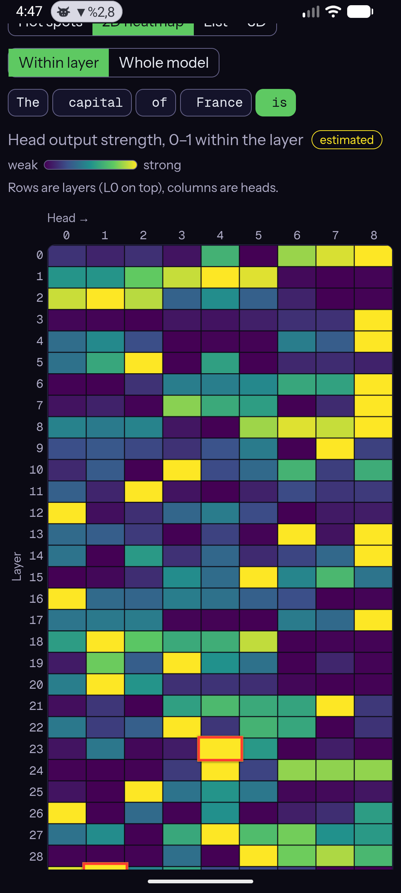</td>
<td>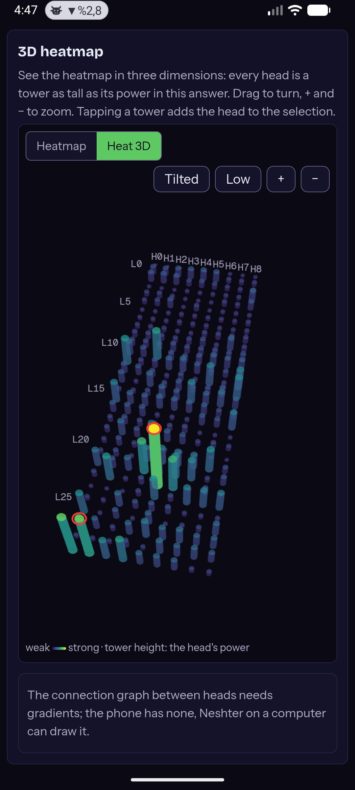</td>
<td>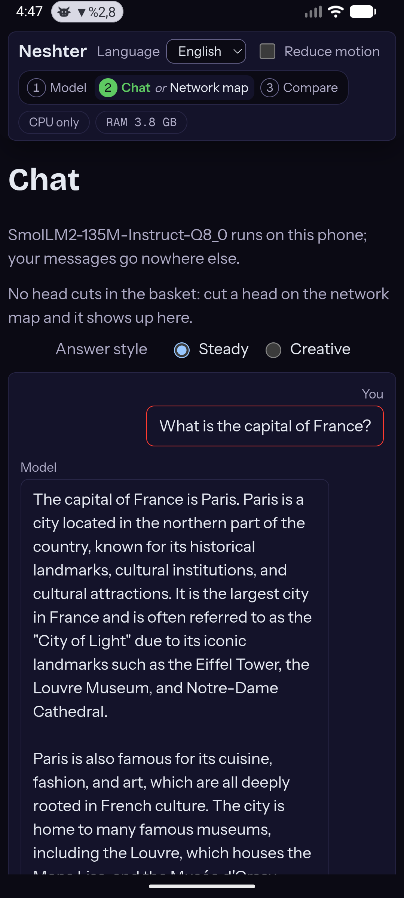</td>
</tr></table>

## What it supports

- **Model families:** Llama, Qwen2 and Gemma2 (up to 8B parameters). Other architectures are rejected.
- **Cut types in v0.1:**
  - **Head ablation:** silence a query attention head (its `o_proj` columns are zeroed).
  - **Direction orthogonalization:** remove a behavior direction from the weights.
- Both keep tensor shapes, so the result is GGUF compatible. Structural pruning is not in v0.1.
- **Verified on real weights:** Qwen2 (Qwen2.5-0.5B), Llama (SmolLM2-135M) and GGUF loading
  (SmolLM2-135M Q8_0). Gemma2 runs on tiny random models in the tests.
- The real effect of a cut is measured as KL divergence against 30 layer-matched random head sets,
  reported as a percentile and a permutation p-value. For recipes with directions the control for each
  direction is a random isotropic unit direction, a weak baseline (the API labels it
  `direction_control: "isotropic"`). Single rates carry Wilson 95% intervals. Test suite differences use
  McNemar's exact test and are reported as "uncertain" (belirsiz) when p >= 0.05. Holm adjustment is
  applied across the non-target categories only; the target category uses its raw McNemar p.
- Suite KL and perplexity are measured through hooks, while the generated answers of direction
  recipes come from baked, save-rounded weights. So "measure what you ship" holds for the answers,
  not for those two numbers.
- On CPUs without native bf16, Neshter computes in float32 when RAM allows. On CPU the default hunt
  method is `activation_diff` (attribution is the GPU recommendation).

## Install and run

Neshter is not published on PyPI yet, so run it from a clone of this repository, with the locked
dependency set (`uv.lock`):

```
git clone https://github.com/ErdemWilkinson/neshter.git
cd neshter
uv run --frozen neshter
```

On Windows you can double-click or run `neshter.bat` in the clone. It runs this checkout with the
lockfile, and if [uv](https://docs.astral.sh/uv/) is missing it asks (Y/N) before installing it with
Astral's official installer script (pinned version). Neshter starts a local server and opens your
browser. Options: `--no-browser`, `--port N`.

On an NVIDIA card: when `neshter.bat` sees one it uses torch's CUDA build (driver 580+; turn it off with
`NESHTER_TORCH=cpu`). By hand: `uv run --frozen --no-group cpu --group gpu neshter`. A plain `uv run`
installs the CPU build.

`uvx --from git+https://github.com/ErdemWilkinson/neshter neshter` also works, but it is unlocked: dependencies resolve to whatever is
newest within the allowed ranges, at your own risk. Do not run a bare `uvx neshter`: until the
package is published, that name on PyPI is not ours.

Apply a shared recipe (`.nester.json`) without the UI:

```
neshter apply recipe.nester.json path/to/model --out path/to/new_model --format safetensors
```

`--format` is `safetensors` (default), `gguf_q4_k_m` or `gguf_q8_0`. Exit codes: `0` ok, `1` error,
`2` the recipe is invalid or does not fit the model, `3` the recipe was made for a different model
(SHA-256 mismatch; add `--force` to apply anyway), `4` llama.cpp is required but not found.

## GGUF and Ollama

GGUF export is **experimental** until it has been tested end-to-end. It needs
[llama.cpp](https://github.com/ggml-org/llama.cpp) on your machine (`convert_hf_to_gguf.py` and
`llama-quantize`). Point the `NESHTER_LLAMA_CPP` environment variable at its folder, or put
`llama-quantize` on your `PATH`. `NESHTER_LLAMA_CPP` must point to a llama.cpp you trust (its Python
converter runs with your rights). Without it, save as safetensors; the GGUF option reports
"llama.cpp required". GGUF and Ollama outputs keep the model card, recipe and license files next to
the `.gguf`.

Importing the saved GGUF into Ollama is optional and **off by default**. When enabled, Neshter runs
`ollama create` for you.

## Security model

- The server binds to `127.0.0.1` only. There is no option to listen on other addresses.
- Every response carries a Content-Security-Policy (`frame-ancestors 'none'`, same-origin only),
  `X-Content-Type-Options: nosniff`, `Referrer-Policy: no-referrer` and `X-Frame-Options: DENY`.
- The sample model download is pinned to one revision and fetches only config, tokenizer, weight and
  license files. Report vulnerabilities privately; see [SECURITY.md](SECURITY.md).
- A random session token is generated at start and required on every API request
  (`X-Neshter-Token`). It travels in the URL fragment, which browsers never send to a server.
- `Origin` must be `http://127.0.0.1:<port>` or `http://localhost:<port>` (or absent), and `Host` must
  be a local address, which blocks cross-site and DNS-rebinding requests.
- `.pt` files are loaded only with `torch.load(weights_only=True)`; otherwise they are rejected.
- `trust_remote_code` is never enabled.
- Your source model is never modified: it is opened read-only and its SHA-256 is checked before and
  after saving. Saves are atomic (`.tmp` folder, then `os.replace`) and never overwrite an existing
  folder.
- Recipes are untrusted input: strict schema, no code, no file paths. From v0.1.1 a recipe's `concept`
  and `method` must match `^[A-Za-z0-9_.-]{1,64}$`, so older recipes with free text there fail to load
  with a clear validation message (edit those two fields to a short id).

## Responsible use

Neshter has a built-in `refusal` concept. Models saved after cutting it carry the metadata
`abliterated: refusal` and a `safety-ablated` tag in the generated model card, because their safety
behavior is reduced. Use such models responsibly, and respect the license of the base model
(for example, the Llama license has naming and use-policy requirements for derivatives).

The safety label is best-effort, meant for honest redistribution, and trivially removable. The base
model's license and use policy still apply to what you save and share. In the app it is applied automatically when the
exported recipe contains one of the top 20 heads or a direction (cosine >= 0.99) found by a refusal
hunt in the current session. The CLI cannot verify what a shared recipe's directions do, so it relies
on the recipe's `concept` being `refusal` or on `neshter apply --label-safety`: use `--label-safety`
whenever you apply a recipe you did not make.

## Status

v0.1 backend: model loading, scanning, head activity maps, concept hunting, comparison, recipes,
export, local API and CLI. The web UI is done: model picker, heatmap, measuring, cutting, compare,
concept hunt, save, drafts and restore, logit lens and attention patterns, and the 3D views (3D heatmap
and the connection graph). An Android app runs GGUF models on the phone (heatmap, 3D heatmap, logit
lens, chat). The UI is dark only for now.

## License

Neshter is licensed under the [Apache License 2.0](LICENSE).
