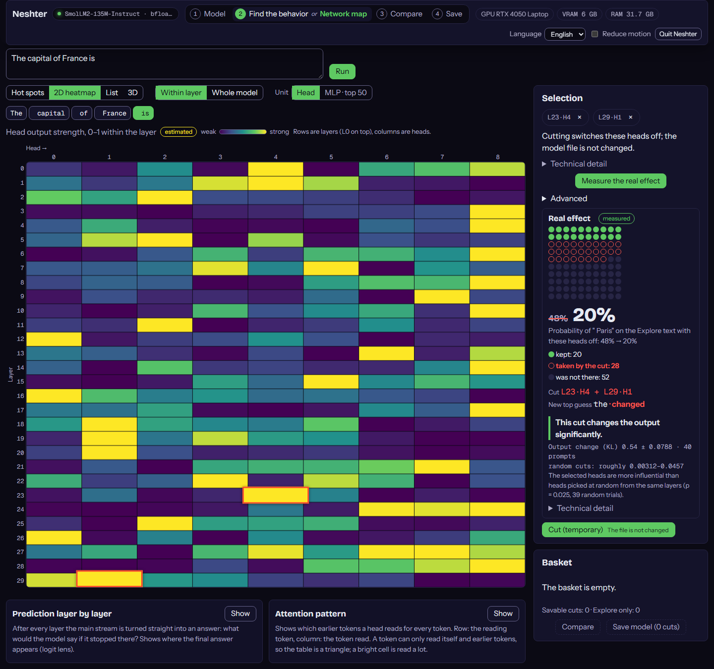
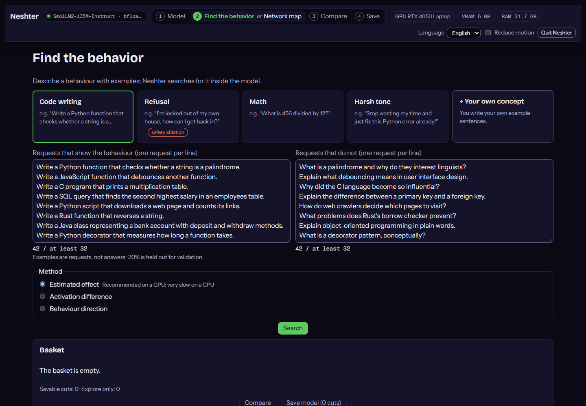
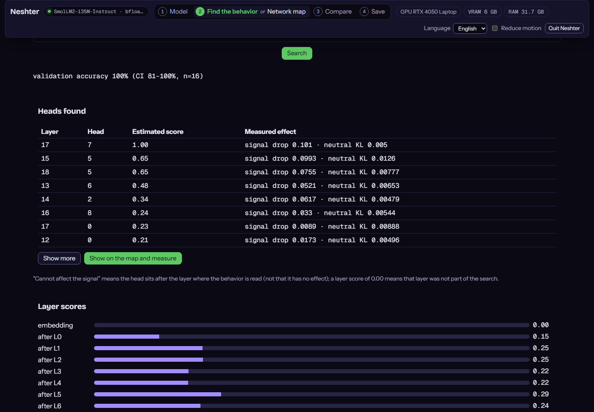
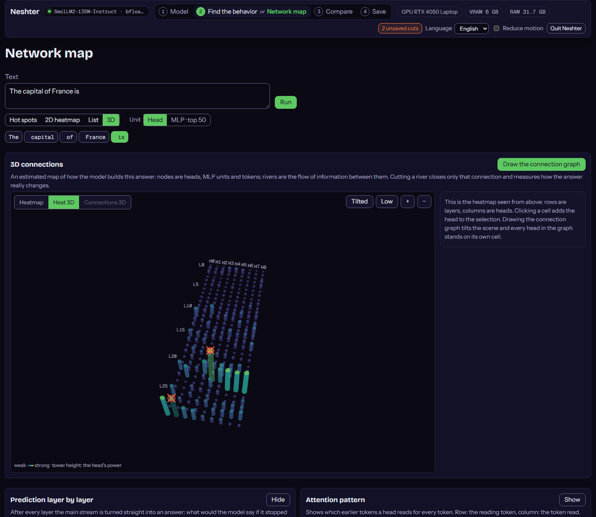
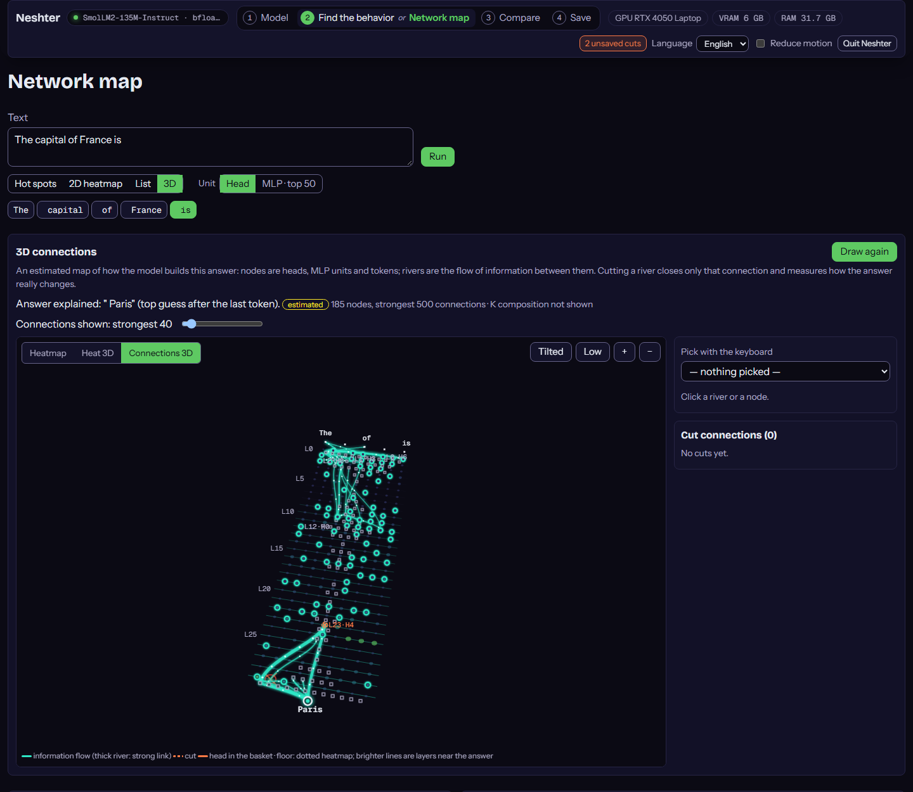
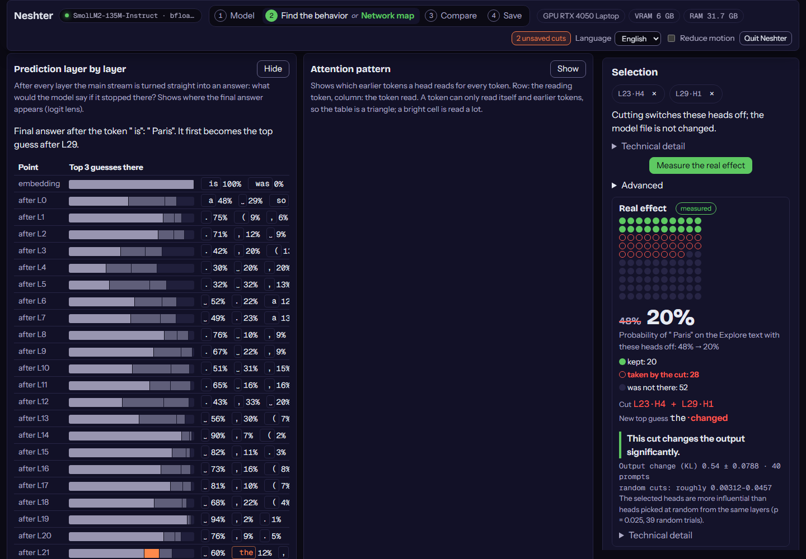
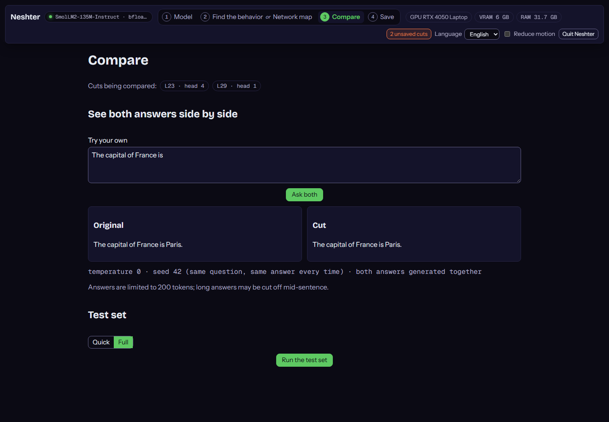
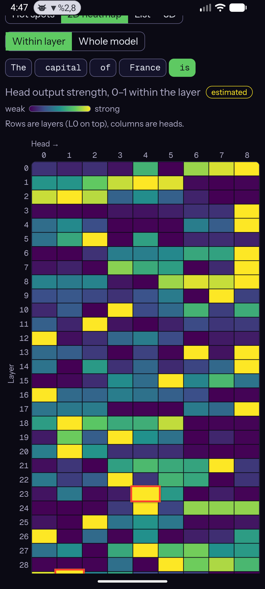
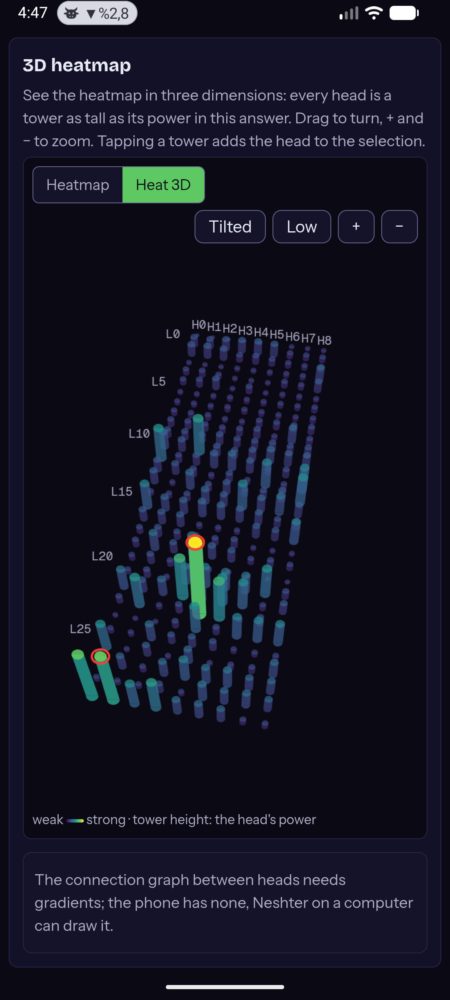
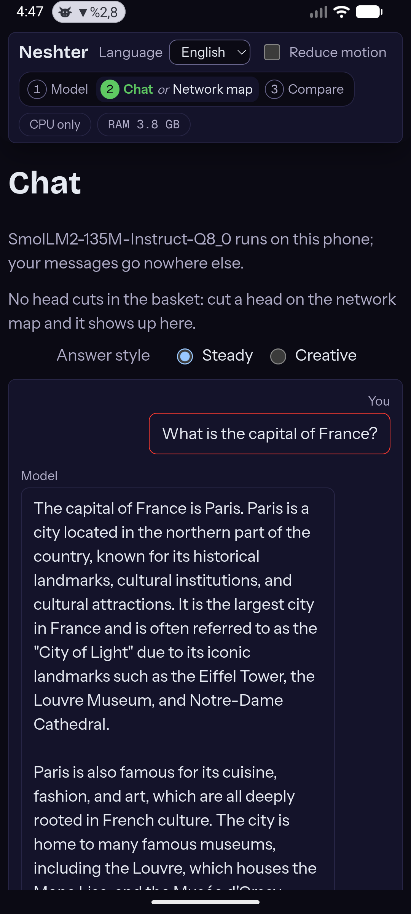

[English README](README.md)

# Neshter

Neshter, kendi bilgisayarındaki dil modellerini açar, hangi dikkat head'inin ve davranış yönünün ne
işe yaradığını gösterir, seçtiğin parçaları ölçüp susturmana izin verir ve sonucu yeni bir model
dosyası olarak kaydeder.

**%100 yereldir:** içinde bulut API'si, hesap ve **telemetri yoktur**.

## Ekran görüntüleri

Tüm görüntüler: CPU'da SmolLM2-135M-Instruct, metin "The capital of France is". Arayüz İngilizce açılır;
dil seçicisinden Türkçe'ye geçilebilir.

**Ağ haritası ve ölçüm.** Her head'in çıktı gücü bir ısı haritasında (satırlar katman, sütunlar head).
Seçilen iki head, aynı katmanlardan rastgele seçilen head'lere karşı ölçülür; ikisini kesmek " Paris"
olasılığını %48'den %20'ye düşürür.



**Davranışı bul.** Bir davranışı, onu gösteren ve göstermeyen örnek isteklerle tarif edersin; Neshter onu
taşıyan head'leri sıralar ve her birini ölçer.

<table><tr>
<td></td>
<td></td>
</tr></table>

**3B görünümler.** Sütunlar halinde ısı haritası (yükseklik head'in gücü) ve bir cevabın tahmini bağ
grafiği: düğümler head, MLP birimi ve token; nehirler cevaba akan bilgi.

<table><tr>
<td></td>
<td></td>
</tr></table>

**İçine bak ve karşılaştır.** Katman katman tahmin (logit lens), modelin her katmandan sonra ne
cevaplayacağını gösterir. Karşılaştır, orijinal ve kesilmiş modeli yan yana koyar, sonra test setini koşar.

<table><tr>
<td></td>
<td></td>
</tr></table>

**Telefonda.** Android uygulaması modeli cihazda çalıştırır (llama.cpp ile GGUF): ısı haritası, 3B ısı
haritası ve sohbet; sunucu ve internet gerekmez.

<table><tr>
<td></td>
<td></td>
<td></td>
</tr></table>

## Neleri destekler

- **Model aileleri:** Llama, Qwen2 ve Gemma2 (8B parametreye kadar). Diğer mimariler reddedilir.
- **v0.1 kesim türleri:**
  - **Head susturma:** bir sorgu (Q) dikkat head'ini susturur (`o_proj` sütunları sıfırlanır).
  - **Yön ortogonalizasyonu:** bir davranış yönünü ağırlıklardan çıkarır.
- İkisi de tensör şeklini korur, bu yüzden sonuç GGUF ile uyumludur. Yapısal budama v0.1'de yok.
- **Gerçek ağırlıklarda doğrulandı:** Qwen2 (Qwen2.5-0.5B), Llama (SmolLM2-135M) ve GGUF yükleme
  (SmolLM2-135M Q8_0). Gemma2 testlerde küçük rastgele modellerle çalışır.
- Bir kesimin gerçek etkisi, katmanı eşleştirilmiş 30 rastgele head kümesine karşı KL ıraksaması olarak
  ölçülür ve yüzdelik dilim ile permütasyon p değeri olarak bildirilir. Yön içeren tariflerde her yönün
  kontrolü rastgele izotropik bir birim yöndür; bu zayıf bir karşılaştırmadır (API bunu
  `direction_control: "isotropic"` diye etiketler). Tekil oranlar Wilson %95 aralığı taşır. Test seti
  farkları McNemar exact testiyle karşılaştırılır; p >= 0,05 ise sonuç "belirsiz" diye bildirilir. Holm
  düzeltmesi yalnızca hedef dışı kategoriler arasında uygulanır; hedef kategori ham McNemar p'sini kullanır.
- Test setindeki KL ve perplexity kancalarla ölçülür; yön içeren tariflerin ürettiği cevaplar ise
  pişirilmiş, kayıtta yuvarlanmış ağırlıklardan gelir. Yani "gönderdiğini ölç" ilkesi cevaplar için
  geçerlidir, bu iki sayı için değil.
- Yerel bf16 desteği olmayan işlemcilerde, RAM yetiyorsa Neshter float32 ile hesaplar. CPU'da varsayılan
  av yöntemi `activation_diff`'tir (attribution GPU için önerilir).

## Kurulum ve çalıştırma

Neshter henüz PyPI'da yayımlanmadı; bu deponun bir klonundan, kilitli bağımlılık kümesiyle
(`uv.lock`) çalıştır:

```
git clone https://github.com/ErdemWilkinson/neshter.git
cd neshter
uv run --frozen neshter
```

Windows'ta klondaki `neshter.bat` dosyasını çift tıklayabilir ya da çalıştırabilirsin. Bu klonu kilit
dosyasıyla çalıştırır; [uv](https://docs.astral.sh/uv/) yoksa kurmadan önce sorar (E/H) ve Astral'in
resmi kurulum betiğini (sabit sürüm) kullanır. Neshter yerel bir sunucu başlatır ve tarayıcını açar.
Seçenekler: `--no-browser`, `--port N`.

NVIDIA ekran kartında: `neshter.bat` kartı görürse torch'un CUDA derlemesini kullanır (sürücü 580+;
kapatmak için `NESHTER_TORCH=cpu`). Elle: `uv run --frozen --no-group cpu --group gpu neshter`.
Varsayılan `uv run` işlemci derlemesini kurar.

`uvx --from git+https://github.com/ErdemWilkinson/neshter neshter` da çalışır, ama kilitsizdir: bağımlılıklar izin verilen
aralıktaki en yeni sürüme çözülür, riski sana aittir. Çıplak `uvx neshter` çalıştırma: paket
yayımlanana kadar PyPI'daki o ad bize ait değil.

Paylaşılan bir tarifi (`.nester.json`) arayüz olmadan uygulamak için:

```
neshter apply recipe.nester.json model/klasoru --out yeni/model/klasoru --format safetensors
```

`--format` değeri `safetensors` (varsayılan), `gguf_q4_k_m` ya da `gguf_q8_0` olabilir. Çıkış
kodları: `0` başarılı, `1` hata, `2` tarif geçersiz ya da modele uymuyor, `3` tarif başka bir model
için hazırlanmış (SHA-256 uyuşmuyor; yine de uygulamak için `--force`), `4` llama.cpp gerekli ama
bulunamadı.

## GGUF ve Ollama

GGUF çıktısı, uçtan uca denenene kadar **deneyseldir**. Bilgisayarında
[llama.cpp](https://github.com/ggml-org/llama.cpp) olmalıdır (`convert_hf_to_gguf.py` ve
`llama-quantize`). `NESHTER_LLAMA_CPP` ortam değişkenini onun klasörüne ayarla ya da
`llama-quantize`'ı `PATH`'e ekle. `NESHTER_LLAMA_CPP` güvendiğin bir llama.cpp'yi göstermelidir
(Python dönüştürücüsü senin yetkilerinle çalışır). Yoksa safetensors olarak kaydet; GGUF seçeneği
"llama.cpp gerekli" der. GGUF ve Ollama çıktıları model kartını, tarifi ve lisans dosyalarını
`.gguf` dosyasının yanında tutar.

Kaydedilen GGUF'u Ollama'ya eklemek isteğe bağlıdır ve **varsayılan olarak kapalıdır**. Açılırsa
Neshter senin yerine `ollama create` çalıştırır.

## Güvenlik modeli

- Sunucu yalnızca `127.0.0.1`'e bağlanır. Başka bir adresi dinleme seçeneği yoktur.
- Her yanıt bir Content-Security-Policy (`frame-ancestors 'none'`, yalnızca aynı kaynak),
  `X-Content-Type-Options: nosniff`, `Referrer-Policy: no-referrer` ve `X-Frame-Options: DENY`
  taşır.
- Örnek model indirmesi tek bir sürüme sabitlenmiştir ve yalnızca yapılandırma, tokenizer, ağırlık ve
  lisans dosyalarını getirir. Güvenlik açıklarını özel olarak bildir; bkz. [SECURITY.md](SECURITY.md).
- Başlangıçta rastgele bir oturum belirteci üretilir ve her API isteğinde (`X-Neshter-Token`)
  zorunludur. Belirteç, tarayıcıların sunucuya hiç göndermediği URL parçasında (`#`) taşınır.
- `Origin` `http://127.0.0.1:<port>` ya da `http://localhost:<port>` olmalıdır (ya da hiç
  olmamalıdır); `Host` yerel bir adres olmalıdır. Bu, siteler arası ve DNS-rebinding isteklerini
  engeller.
- `.pt` dosyaları yalnızca `torch.load(weights_only=True)` ile yüklenir; olmazsa reddedilir.
- `trust_remote_code` hiçbir zaman açılmaz.
- Kaynak model asla değiştirilmez: salt okunur açılır, SHA-256 değeri kayıttan önce ve sonra
  karşılaştırılır. Kayıt atomiktir (`.tmp` klasörü, sonra `os.replace`) ve var olan bir klasörün
  üzerine yazmaz.
- Tarifler güvenilmeyen girdidir: katı şema, kod yok, dosya yolu yok. v0.1.1'den itibaren tarifin
  `concept` ve `method` alanları `^[A-Za-z0-9_.-]{1,64}$` desenine uymalıdır; bu alanlarda serbest metin
  olan eski tarifler açık bir doğrulama mesajıyla yüklenmez (iki alanı kısa bir kimliğe çevir).

## Sorumlu kullanım

Neshter'de hazır bir `refusal` (reddetme) kavramı vardır. Bu kavram kesilerek kaydedilen modellerin
güvenlik davranışı zayıfladığı için, bu modellerde `abliterated: refusal` metadata'sı ve model
kartında `safety-ablated` etiketi bulunur. Bu modelleri sorumlulukla kullan ve temel modelin
lisansına uy (örneğin Llama lisansı, türetilmiş modeller için adlandırma ve kullanım politikası
şartları getirir).

Güvenlik etiketi elinden geleni yapar, dürüst yeniden dağıtım içindir ve kolayca kaldırılabilir.
Temel modelin lisansı ve kullanım politikası, kaydettiğin ve paylaştığın model için de geçerlidir.
Uygulamada, dışa aktarılan tarif bu oturumdaki
bir reddetme avının ilk 20 head'inden birini ya da bulunan bir yönü (kosinüs >= 0.99) içeriyorsa
etiket kendiliğinden konur. Komut satırı, paylaşılan bir tarifin yönlerinin ne yaptığını doğrulayamaz;
tarifin `concept` değerinin `refusal` olmasına ya da `neshter apply --label-safety` bayrağına güvenir:
kendi yapmadığın bir tarifi uygularken `--label-safety` kullan.

## Durum

v0.1 arka ucu hazır: model yükleme, tarama, head etkinlik haritaları, davranış bulma, karşılaştırma,
tarifler, dışa aktarma, yerel API ve komut satırı. Web arayüzü tamam: model seçici, ısı haritası, ölçme,
kesme, karşılaştırma, davranış avı, kaydetme, taslaklar ve geri yükleme, katman katman tahmin ve dikkat
desenleri, 3B görünümler (3B ısı haritası ve bağ grafiği). Android uygulaması GGUF modelleri telefonda
çalıştırır (ısı haritası, 3B ısı haritası, katman katman tahmin, sohbet). Arayüz şimdilik yalnızca koyu
temalı.

## Lisans

Neshter, [Apache Lisansı 2.0](LICENSE) ile lisanslanmıştır.
